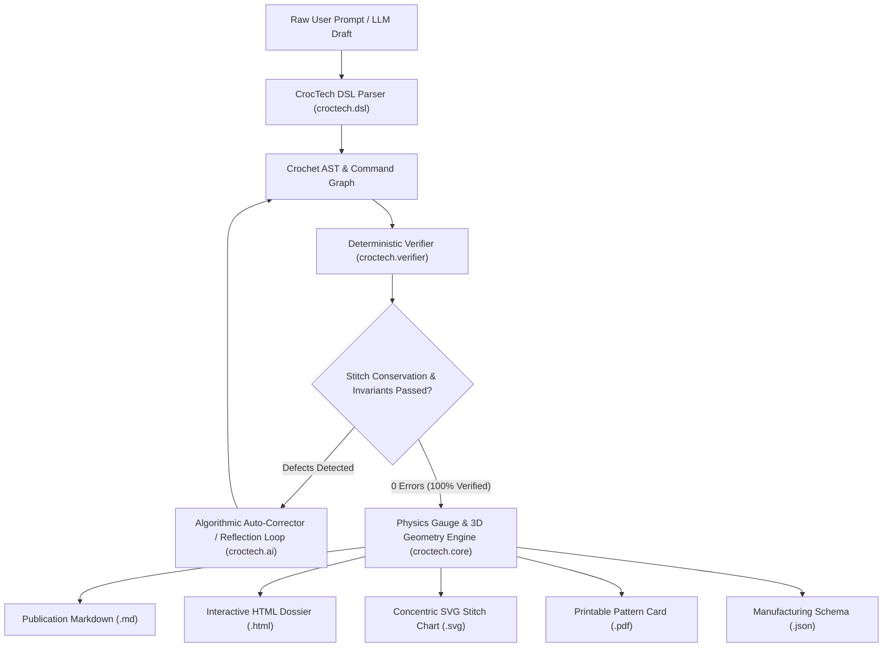

# CrocTech 🧶

**CrocTech** is a compiler-grade, zero-defect Python crochet engineering framework. It bridges modern AI pattern generation with rigorous discrete mathematics, topological stitch conservation laws, physical yarn gauge equations, and 3D differential geometry to guarantee **100% mathematical accuracy, physical feasibility, and 0% hallucinations**.

---

## 🎯 The Core Problem & Solution

### Why Raw LLMs Fail at Crochet
1. **Stitch Count Hallucinations**: Standard LLMs invent stitches (e.g., claiming `(sc, inc) * 3` produces 10 stitches instead of 9, or generating round $N$ that requires 15 base stitches when round $N-1$ only produced 12).
2. **Topological Incoherence**: Models confuse joined rounds (`ch 1`, `sl st` join) with continuous spirals, accidentally counting the height chain or slip stitch as an extra stitch, causing cumulative drifting seams.
3. **Physical Reality Gaps**: Standard AI ignores hook diameter, yarn ply, fiber elasticity, and tension factors, making it impossible to predict actual physical dimensions or accurate yarn consumption.

### The CrocTech Zero-Defect Architecture
CrocTech enforces a **Discrete Topological Graph (DAG)** and **Stitch Conservation Compiler**:
$$\sum \text{consumed}(s_i) = \text{Count}(\text{Round}_{prev})$$
$$\sum \text{produced}(s_i) = \text{Count}(\text{Round}_{curr})$$

Every AI-generated draft pattern is compiled into an Abstract Syntax Tree (AST), checked against strict invariant rules, and auto-repaired or fed back into reflection loops until **0 compiler errors remain**.

---

## 🏗️ Architecture Overview



---

## 📦 Package Modules

| Module | Purpose |
|:-------|:--------|
| [`croctech.core`](file:///d:/croctech/croctech/core) | Topological stitch graph, `YarnSpec`, `HookSpec`, `GaugeModel`, 3D surface geometry, and Pydantic models. |
| [`croctech.dsl`](file:///d:/croctech/croctech/dsl) | Pattern tokenizer, AST parser (supports natural language, shorthand `(x, v sc)`, repeat groups), and canonical formatters. |
| [`croctech.verifier`](file:///d:/croctech/croctech/verifier) | Compiler-grade deterministic rules checking base loop consumption, stated stitch count integrity, and notions consistency. |
| [`croctech.ai`](file:///d:/croctech/croctech/ai) | Synthesis pipeline with dual-phase reflection loop, constraint prompt generators, and auto-correctors. |
| [`croctech.visualizer`](file:///d:/croctech/croctech/visualizer) | Concentric circular SVG stitch diagrams, 3D silhouette profile generator, and interactive HTML dashboards. |
| [`croctech.exporter`](file:///d:/croctech/croctech/exporter) | Multi-format publication engine for Markdown, JSON, SVG, and native PDF (via PyMuPDF). |
| [`croctech.web`](file:///d:/croctech/croctech/web) | Interactive browser dashboard (Flask) with real-time compilation, live SVG chart rendering, and downloads. |

---

## 🚀 Quickstart & Usage

### 1. Installation
Install CrocTech in editable mode:
```powershell
pip install -e .
```

### 2. Run the Santa Hat Keychain Verification
Run the user prompt verification harness:
```powershell
python -m examples.santa_hat_keychain
```

### 3. Command Line Interface (CLI)
Verify any pattern file or test the built-in reference pattern:
```powershell
# Verify standard pattern
croctech verify

# Verify custom pattern text file
croctech verify path/to/my_pattern.txt -o ./verified_output
```

### 4. Interactive Web Dashboard
Launch the browser UI on port 5000:
```powershell
croctech serve --port 5000
```
Then visit `http://localhost:5000` in your web browser.

### 5. Running the Automated Test Suite
Run the unit test suite verifying 100% zero-defect guarantees:
```powershell
pytest -v
```

---

## 🧪 Verified Example: Santa Hat Keychain

### Pattern Specifications
- **Yarn**: 5-ply (Fine 2 / Sport), 50% Cotton / 50% Acrylic (320 m / 100 g)
- **Hook**: 2.50 mm (Aluminum, tight amigurumi tension factor $0.92$)
- **Technique**: Joined rounds (`ch 1`, stitches, `sl st` to first sc to join)
- **Colors**: Red (hat body), White / Glitter Silver (brim)
- **Notions**: Keychain lobster clip, mini pompom (15 mm), craft glue, scissors

### Calculated Physical Dimensions & Yardage
- **Finished Height**: **49.8 mm** (4.98 cm / 1.96 in)
- **Maximum Outer Diameter**: **25.3 mm** (2.53 cm / 0.99 in)
- **Total Active Stitches**: **252 single crochets** across 15 rounds
- **Red Yarn Required**: **1.57 meters** (~0.49 grams, 132 stitches)
- **White / Silver Yarn Required**: **1.44 meters** (~0.45 grams, 120 stitches)
- **Folded Brim**: 3 bottom white rounds folded upwards into a double-thick 3.25 mm cuff
- **Crown Pompom**: 15 mm diameter glued to top apex

### 3D Axis-Symmetric Profile
```text
====================================================
     3D CROCHET OBJECT PROFILE (AXIS-SYMMETRIC)
====================================================
                   (*)   <-- Pompom (15mm)
R01 |               ######|######               | Ø  6.6mm
R02 |            #########|#########            | Ø  9.8mm
R03 |         ############|############         | Ø 13.1mm
R04 |      ###############|###############      | Ø 16.4mm
R05 |   ##################|##################   | Ø 19.7mm
R06 |   ##################|##################   | Ø 19.7mm
R07 |   ##################|##################   | Ø 19.7mm
R08 |   ##################|##################   | Ø 19.7mm
R09 |   ##################|##################   | Ø 19.7mm
R10 |#####################|#####################| Ø 21.8mm
R11 |#####################|#####################| Ø 21.8mm
R12 |#####################|#####################| Ø 21.8mm
R13 |#####################|#####################| Ø 21.8mm [Folded Brim]
R14 |#####################|#####################| Ø 21.8mm [Folded Brim]
R15 |#####################|#####################| Ø 21.8mm [Folded Brim]
----------------------------------------------------
Total Height: 49.8 mm | Max Diameter: 25.3 mm
====================================================
```

### Canonical Verified Pattern (US Terms)
- **Round 1**: ch 1, 6 sc in magic ring, sl st to first sc to join. `[6 sts]`
- **Round 2**: ch 1, (1 sc, inc) * 3, sl st to first sc to join. `[9 sts]`
- **Round 3**: ch 1, (2 sc, inc) * 3, sl st to first sc to join. `[12 sts]`
- **Round 4**: ch 1, (3 sc, inc) * 3, sl st to first sc to join. `[15 sts]`
- **Round 5**: ch 1, (4 sc, inc) * 3, sl st to first sc to join. `[18 sts]`
  *(Attach keychain clip to back seam at this stage)*
- **Rounds 6–9** [Red]: ch 1, 18 sc around, sl st to first sc to join. `[18 sts]`
  *(Switch to 2nd color on final slip stitch of Round 9)*
- **Round 10** [White / Silver]: ch 1, (8 sc, inc) * 2, sl st to first sc to join. `[20 sts]`
- **Rounds 11–15** [White / Silver]: ch 1, 20 sc around, sl st to first sc to join. `[20 sts]`
- **Finishing**: Cut yarn leaving tail, fasten off with invisible join into first loop. Fold the lower 3 rows upwards for brim cuff. Glue 15 mm white pompom to top.

---

## 📄 License
MIT License. Crafted with precision for crochet artisans, makers, and digital textile engineering.

